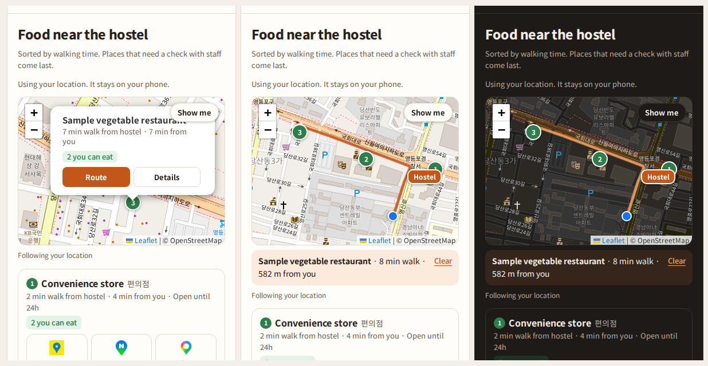

# 🍽️ Tour Companion

**외국인 참가자가 _말하지 않아도_ 자기 식단에 맞는 음식을 찾게 돕는 링크**

*A link that helps international participants find food they can eat — without having to ask.*

[**👉 직접 써보기**](https://glocalcrew.github.io/) · [기획 배경](#-왜-만들었나) · [주요 기능](#-주요-기능) · [설계 결정](#-설계-결정)

---

## 💡 왜 만들었나

> 외국인 대상 지역 투어에서 **참가자 10명이 제공된 식사를 먹지 못했다.**
> 해산물 알레르기, 할랄, 채식이 섞여 있었고, 메뉴는 김밥 · 만두 · 바지락 칼국수였다.
> 운영진은 1인당 1만 원을 건넸고, 참가자들은 단체 채팅방에서 서로 물어 식당을 찾았다.
>
> **운영 스태프였던 나도 누가 무엇을 못 먹는지 다 기억하지 못했다.**

기존 앱(할랄 식당 앱, 비건 식당 앱, 관광공사 사이트, 무슬림 생활 앱)을 직접 써보니 공통된 빈틈이 있었다.

| 기존 서비스가 알려주는 것 | 이 서비스가 알려주는 것 |
| --- | --- |
| 이 식당이 할랄 · 비건인가 | **이 메뉴에** 내가 못 먹는 재료가 들어가는가 |
| 내 주변 식당 | **집합 장소에서 걸어갈 수 있고, 시간 안에 돌아올 수 있는** 곳 |
| 가게 이름으로 지도 검색 | **좌표**로 정확한 위치 연결 |

---

## ✨ 주요 기능

### 🥢 음식 · Food
- **"무엇을 못 드세요?"** 라벨이 아니라 **재료**로 고른다 (돼지고기, 젤라틴, 멸치 육수, 젓갈 …)
- 할랄 · 비건 · 해산물 알레르기 **바로가기**는 재료를 미리 체크해 줄 뿐, 내 기준대로 고칠 수 있다
- 단체 식사 메뉴를 **먹을 수 있음 / 확인 필요 / 못 먹음** 으로 나눠 보여준다
- 고른 조건은 **내 휴대폰에만** 저장된다

### 🗺️ 근처 · Nearby
- 지도에 호스텔, 내 위치, 먹을 수 있는 식당이 핀으로 보인다
- 핀을 누르면 식당 카드 → **길 보기**를 누르면 걷는 길이 선으로 그려진다
- 실제 길안내는 **카카오맵 · 네이버지도 · 구글 지도**로 좌표를 넘긴다

### 🕒 오늘 · Today
- 서울 시간 기준으로 **지금 어느 일정인지** 막대가 움직인다
- 늦거나 길을 잃으면 **전화 · 문자**로 바로 연락
- **한국어 / English** 전환, 밝은 · 다크 모드 지원

---

## 🧭 설계 결정

| 결정 | 이유 |
| --- | --- |
| **시작 화면을 없앴다** | 배고픈 사람에게는 한 단계라도 줄이는 게 낫다 |
| **"안전합니다"라고 말하지 않는다** | 알레르기는 취향이 아니라 안전의 문제. 사실과 확인 여부만 보여준다 |
| **국적으로 식단을 추측하지 않는다** | 같은 나라 사람도 기준이 다르다. 본인이 직접 고르게 한다 |
| **말하지 않아도 되게 한다** | 단체 행사에서는 "저 이거 못 먹어요"라고 말하기 어렵다 |
| **재촉하지 않는다** | 남은 시간은 분 단위 어림값으로, 알림은 한 번만, 빨간 경고 없이 |
| **길안내는 직접 만들지 않는다** | 참가자가 이미 쓰는 지도 앱에 좌표로 정확히 넘기는 게 더 낫다 |
| **확인 안 된 식당은 숨긴다** | 식이 조건 앱에서 틀린 정보는 정보가 없는 것보다 나쁘다 |

---

## 🔍 경쟁 서비스에서 배운 것

- 한 앱은 지도 버튼이 **가게 이름만** 넘겨서, 다른 지역의 같은 이름 가게나 엉뚱한 가게로 연결됐다 → **좌표로 연결**
- 같은 단어(Self-certified 등)가 **서비스마다 다른 뜻**이었다 → **라벨 대신 재료**
- 살펴본 4곳 중 3곳이 **정보의 정확성을 보증하지 않는다**고 밝혔다 → **확인일과 확인 방법 표시**
- 거리순인데 **제휴 식당이 위로** 올라오는 경우가 있었다 → **광고가 순서를 바꾸지 않는다**

---

## 🧪 시범 적용

서울에서 열린 외국인 청년 프로그램(1박 2일, 참가자 약 15명)에 시범 적용했다.

| 확인하려는 것 | 결과 |
| --- | --- |
| 식사 전에 메뉴를 미리 확인하는가 | *행사 후 업데이트* |
| 못 먹은 사람이 줄었는가 (이전 투어: 10명) | *행사 후 업데이트* |
| 직접 고르는 방식이 편한가 | *행사 후 업데이트* |

> 이번 행사는 서울에 사는 외국인이 대상이라, "지방에서 처음 온 관광객"이라는 핵심 상황은 다음 지역 투어에서 검증할 예정이다.

---

## 🛠️ 만든 방법

| 구분 | 사용한 것 | 비용 |
| --- | --- | --- |
| 화면 | HTML 파일 하나 (설치 없이 링크로 열림) | 무료 |
| 지도 | [Leaflet](https://leafletjs.com) + [OpenStreetMap](https://www.openstreetmap.org/copyright) | 무료 |
| 도보 경로 | [FOSSGIS](https://routing.openstreetmap.de) 공개 길찾기 서버 | 무료 |
| 배포 | GitHub Pages | 무료 |

- 서버와 데이터베이스가 없다. 위치와 식단 정보는 **기기 밖으로 나가지 않는다.**
- 기획 · 화면 설계 · 정책은 직접 했고, 시제품 코드는 **AI 코딩 도구(Claude)** 를 활용해 만들었다.

---

## 🚧 한계와 다음 단계

- [ ] 식당 · 메뉴 재료를 직접 확인한 데이터로 채우기
- [ ] 일정 · 메뉴를 **구글 시트**에서 불러와 운영자가 코드 없이 고치기
- [ ] 참가자 식이 조건을 **이름 없이 숫자로** 운영자에게 전달하기
- [ ] **함께 먹기 모드**: 조원 모두가 먹을 수 있는 메뉴가 있는 식당 찾기
- [ ] 지방 관광지 투어에서 다시 검증하기

---

**기획 · 설계** [JUNGWON SONG] · 2026

지도 데이터 © [OpenStreetMap contributors](https://www.openstreetmap.org/copyright)

